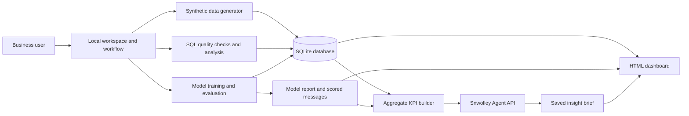

# Architecture and Data Model

## Current prototype

The prototype runs on one computer. A local browser workspace collects business context and a prediction goal. A small Python workflow controller runs data generation, SQL analysis, model training, Snwolley summarization, and report generation in order. SQLite stores the synthetic data; Python writes evaluation and prediction artifacts; the dashboard reads the database and saved reports.

The workspace can select either response or conversion as the prediction target for delivered messages. Both goals use the same campaign schema and pre-send features. The API key is stored outside source code in `.env`; only aggregate synthetic measures are sent to Snwolley.

## Relational data model

| Table | Purpose and key fields | Relationships |
| --- | --- | --- |
| `businesses` | Workspace identity and industry (`business_id` primary key). | One business has many customers and campaigns. |
| `customers` | Synthetic customer profile, segment, region, tenure, preferred contact hour, and consent status (`customer_id` primary key, `business_id` foreign key). | Many customers belong to one business; one customer can receive many messages. |
| `campaigns` | Campaign name, offer, send date, and send hour (`campaign_id` primary key, `business_id` foreign key). | Many campaigns belong to one business; one campaign can contain many messages. |
| `messages` | One customer’s campaign delivery attempt, with delivery status, response, conversion, and timestamp (`message_id` primary key; campaign/customer foreign keys). | Joins a customer to a campaign and records the outcomes for that message. |

Primary and foreign keys maintain record identity and links. Boolean checks constrain response and conversion to 0 or 1; indexes support campaign and customer lookups. The generator deliberately includes missing regions and repeated external customer keys to demonstrate quality checks. All records are synthetic.

## Production evolution and operations

For a larger batch workload, expose ingestion and analysis through authenticated APIs, validate files before loading, and use a managed relational database with tenant-level access controls, backups, and schema migrations. A scheduler can run daily or campaign-triggered SQL and model jobs; a queue can isolate long-running tasks and retry transient Snwolley calls while respecting its rate limit.

For streaming events, Kafka can buffer message delivery and response events. Consumers can validate and aggregate them into the analytical store; Elasticsearch can support flexible search over operational event logs when that need exists. Grafana can display service health, job latency, data freshness, request failures, and model-quality indicators. These technologies are future options, not dependencies of this demo.

Operational controls should include authentication and authorization, consent and retention rules, encrypted connections, secret management, audit logs, data-quality gates, model versioning, drift and performance alerts, rollback procedures, and human review before any targeting decision. Snwolley should receive only the minimum aggregate context needed to produce a brief. The current prototype has local validation, SQL checks, API timeout/error handling, and basic console logging; it does not provide production monitoring or access control.

